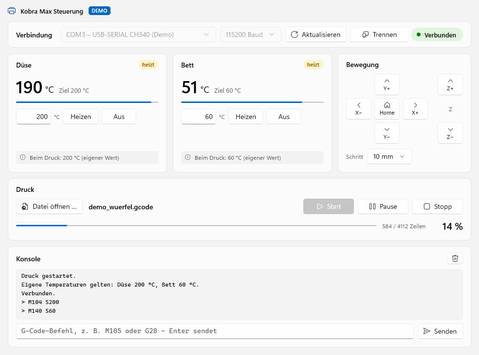

<div align="center">


# Kobra Max Steuerung

**Native Windows-App zum Steuern eines Anycubic Kobra Max über USB** – heizen, fahren, G-Code drucken.<br>
WinUI 3 · C# · .NET 10 · keine Installation, keine Admin-Rechte

[](https://github.com/QMAXC/kopra-max/actions/workflows/build.yml)
[](https://github.com/QMAXC/kopra-max/releases/latest)

[**⬇ KobraMax-win-x64.zip herunterladen**](https://github.com/QMAXC/kopra-max/releases/latest/download/KobraMax-win-x64.zip)

<br>

<picture>
  <source media="(prefers-color-scheme: dark)" srcset="docs/screenshots/app-dark.png">
  
</picture>

<sub>Die Screenshots werden bei jedem Push auf <code>main</code> automatisch neu aufgenommen (App im Demo-Modus auf einem Windows-Runner).</sub>

</div>

---

## Funktionen

| | |
|---|---|
| 🔌 **Verbindung** | COM-Port mit Beschreibung, CH340 wird automatisch vorausgewählt, 115200 oder 250000 Baud |
| 🌡️ **Temperatur** | Düse und Bett live (alle 3 s), heizen/aus, Grenzen 260 °C / 110 °C |
| 🎯 **Temperatur-Override** | „Heizen" merkt sich den Wert – Heizbefehle aus der Datei (`M104`, `M109`, `M140`, `M190`, `G10`, `M568`, auch `R`-Parameter) werden beim Druck ersetzt, `S0` bleibt |
| 🛡️ **Wächter** | Ändert der Drucker sein Ziel während des Drucks, wird der eigene Wert wiederhergestellt (höchstens alle 5 s) |
| 🕹️ **Bewegung** | X/Y/Z in 1, 10 oder 50 mm, Home – während des Drucks gesperrt |
| 🖨️ **Druck** | G-Code laden und säubern, Start / Pause / Stopp, Fortschritt, Ruhezustand wird verhindert |
| 💬 **Konsole** | Eigene Befehle (automatisch in Großbuchstaben), Antworten des Druckers |
| 🧪 **Demo-Modus** | `KobraMax.exe --demo` – simulierter Drucker zum Ausprobieren ohne Hardware |

## Installieren mit einem Befehl

**Windows-Taste → `cmd` → Enter**, dann diese Zeile einfügen (Rechtsklick) und Enter drücken:

```bat
mkdir "H:\3d druk" 2>nul & curl -fL -o "%TEMP%\KobraMax.zip" https://github.com/QMAXC/kopra-max/releases/latest/download/KobraMax-win-x64.zip && tar -xf "%TEMP%\KobraMax.zip" -C "H:\3d druk" && start "" "H:\3d druk\KobraMax\KobraMax.exe"
```

Das braucht **kein PowerShell und keine Admin-Rechte** – nur `curl` und `tar`, die in Windows 10/11 eingebaut sind.
Es lädt die neueste Version, entpackt sie nach `H:\3d druk\KobraMax` und startet die App. Beim ersten Start legt
die App selbst die Verknüpfung **Kobra Max Steuerung** auf den Desktop. Denselben Befehl später erneut
ausführen = **aktualisieren** (vorher die App schließen).

Alternativ [`install.cmd`](install.cmd) herunterladen und doppelklicken (wählt ohne Laufwerk H: automatisch
`%LOCALAPPDATA%\KobraMax`). Auf PCs, auf denen PowerShell erlaubt ist, geht auch:
`powershell -NoProfile -ExecutionPolicy Bypass -Command "irm https://raw.githubusercontent.com/QMAXC/kopra-max/main/install.ps1 | iex"`

## Von Hand installieren

1. [`KobraMax-win-x64.zip`](https://github.com/QMAXC/kopra-max/releases/latest/download/KobraMax-win-x64.zip) herunterladen.
2. Nach **`H:\3d druk\`** entpacken.
3. `H:\3d druk\KobraMax\KobraMax.exe` doppelklicken → **Verbinden** → **Datei öffnen …** → **Start**.

Ausführlich mit Problemlösungen: **[ANLEITUNG.md](ANLEITUNG.md)**. Im ZIP liegen außerdem Testdateien
(Temperaturturm 220–190 °C und ein kleines Testhaus).

## Bauen

Die App lässt sich nur unter **Windows** bauen (Windows App SDK). Benötigt wird nur das
[.NET 10 SDK](https://dotnet.microsoft.com/download) – Visual Studio ist optional.

```powershell
dotnet test tests/KobraMax.Tests
dotnet publish src/KobraMax.App -c Release -o out/KobraMax
```

Ergebnis: `out/KobraMax/KobraMax.exe` samt DLLs (self-contained, unpackaged, läuft ohne installiertes
.NET oder Windows App SDK). Die Logik und die Tests (`KobraMax.Core`, `KobraMax.Tests`) laufen auch
unter Linux und macOS.

### Automatisch bei jedem Push

Der Workflow [`build.yml`](.github/workflows/build.yml) …

1. führt alle Tests aus (Linux und Windows),
2. baut die App und packt sie als `KobraMax-win-x64.zip` (Download unter *Actions → Artifacts*),
3. startet die fertige `.exe` im Demo-Modus und nimmt Screenshots im hellen und dunklen Design auf,
4. auf `main`: veröffentlicht ein **Release** `v1.0.<Nummer>` mit der ZIP-Datei und aktualisiert die Screenshots in diesem README.

## Aufbau

```
KobraMax.slnx
├─ src/KobraMax.Core/      Logik ohne Oberfläche (net10.0) – testbar überall
│   ├─ PrinterSession        Drucker-Thread: Warteschlange, Ping-Pong, Druck, Wächter
│   ├─ TemperatureOverride   Heizbefehle umschreiben (reine Funktion)
│   ├─ TemperatureReport     "T:230.16 /230.00 B:60.01 /60.00" lesen
│   ├─ GcodeFile             Laden & Säubern (Kommentare, N123, *45)
│   ├─ MainViewModel         die komplette Bedienlogik der Oberfläche
│   ├─ PrinterEvent          typisierte Meldungen (abstract record)
│   ├─ SerialPortTransport   System.IO.Ports
│   └─ DemoPrinter           simulierter Marlin für --demo und Screenshots
├─ src/KobraMax.App/       WinUI 3 – nur Anzeige (Fenster in C# aufgebaut, Fluent-Design, Mica)
├─ tests/KobraMax.Tests/   xUnit mit simuliertem Marlin (FakeMarlin)
├─ tools/                  Python-Referenz (drucker_gui.py) und Testdatei-Generator
└─ docs/                   Handoff-Dokument und Screenshots
```

**Protokoll:** ein Befehl, dann auf `ok` warten. Manuelle Befehle gehen vor der nächsten Druckzeile raus.
Zeilen mit `Error` beenden den Befehl und brechen einen laufenden Druck ab. Beim Öffnen des Ports startet
der Drucker neu – deshalb 3 Sekunden warten und den Eingangspuffer leeren.

**Typsicher:** `Nullable` an, keine `dynamic`, alle Warnungen sind Fehler (`Directory.Build.props`).
Zahlen werden immer mit `InvariantCulture` gelesen – sonst würde ein deutsches Windows `230.16` falsch verstehen.

## Startparameter

| Parameter | Wirkung |
|---|---|
| `--demo` | Simulierter Drucker auf „COM3", startet einen Beispieldruck |
| `--theme=light` / `--theme=dark` | Helles oder dunkles Design erzwingen |
| `--screenshot=bild.png` | (mit Demo) nach 9 s Screenshot speichern und beenden – nutzt der Workflow |

## Hardware

Anycubic Kobra Max · Marlin · CH340-USB-Chip · 115200 Baud · Befehle nur in Großbuchstaben ·
Bowden, 1,75 mm Filament, 0,4-mm-Düse.
